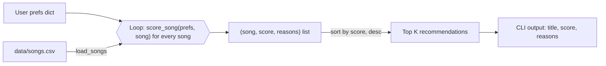

# 🎵 Music Recommender Simulation

## Project Summary

In this project you will build and explain a small music recommender system.

Your goal is to:

- Represent songs and a user "taste profile" as data
- Design a scoring rule that turns that data into recommendations
- Evaluate what your system gets right and wrong
- Reflect on how this mirrors real world AI recommenders

**My version (VibeFinder 1.0)** is a CLI-first, content-based recommender. It loads an 18-song catalog from `data/songs.csv`, scores every song against a user's taste profile (favorite genre, favorite mood, target energy, and optionally acoustic preference and target valence), ranks the catalog, and prints the top 5 songs. Each pick comes with a list of reasons showing where its points came from, for example `genre match (+2.0)`.

---

## How The System Works

### How real-world recommenders work (research summary)

Platforms like Spotify and YouTube mix two main approaches:

- **Collaborative filtering** uses other people's behavior. If listeners who share your history also loved song X, you'll probably like X too. It looks at the user × item interaction matrix (plays, likes, skips, saves, playlist adds) and does not need to know anything about the audio. It's strong at surprising "you might also like" picks. It's weak at the **cold-start** problem, since a new song or new user has no history yet, and it tends to boost already-popular items.
- **Content-based filtering** uses the item's own attributes. It recommends songs whose features (genre, tempo, energy, mood, acousticness, lyrics, audio embeddings) resemble what you already like. It works on day one for a brand-new song, but it can trap you in a **filter bubble** of near-identical tracks.

Production systems are **hybrids**. Spotify's Discover Weekly, for example, blends collaborative signals from billions of playlists with NLP on text about artists and with audio models. A large-scale pipeline usually has two stages: **candidate generation** pulls a few hundred plausible tracks out of millions, then a **ranking model** orders them using many signals.

**Main data types involved**

| Type | Examples | Used by |
|---|---|---|
| Explicit feedback | likes/hearts, thumbs down, follows, ratings | Collaborative |
| Implicit feedback | plays, **skips** (strong negative signal), replays, listen duration, saves, **playlist adds** | Collaborative |
| Context | time of day, device, activity, session sequence | Ranking |
| Audio / content features | **tempo**, energy, valence (**mood**), danceability, acousticness, key, loudness | Content-based |
| Metadata | genre, artist, release year, lyrics, editorial tags | Content-based |

**What my version prioritizes:** a simulator has no other users, so it is **purely content-based**. It weights the categorical "identity" of a song (genre, then mood) most heavily, and uses numeric audio features as a **similarity** signal: songs *close to* the user's target energy score higher, not simply songs with more energy.

### Feature analysis of `songs.csv`

Available columns: `id, title, artist, genre, mood, energy, tempo_bpm, valence, danceability, acousticness`.

- **Most useful:** `genre` and `mood` (clear, human-meaningful categories), `energy` (the strongest single "vibe" axis, intense vs. chill), and `acousticness` (separates guitar/piano/lofi from electronic/produced tracks).
- **Useful secondary:** `valence` (musical positivity, helps tell "happy" from "moody" at the same energy).
- **Skipped for now:** `tempo_bpm` mostly duplicates energy in this catalog (fast songs are also high-energy) and is on a different scale. `danceability` overlaps with energy too.
- **Does this match how I define a "vibe"?** Mostly. For me a vibe is energy plus emotional color, which maps well to energy plus valence/mood. What it misses is texture (vocals vs. instrumental, lyrics, era), which the CSV doesn't capture.

### Data: expanded catalog

The starter had 10 songs (pop, lofi, rock, ambient, jazz, synthwave, indie pop). I added 8 more covering genres and moods that weren't there yet: **hip hop/confident, metal/angry, classical/peaceful, country/nostalgic, reggae/uplifting, edm/euphoric, r&b/romantic, blues/sad**. The catalog now has 18 songs, 15 genres, and 14 moods.

### Objects and features

**`Song`**: `id, title, artist, genre, mood, energy, tempo_bpm, valence, danceability, acousticness`
(the scorer uses `genre`, `mood`, `energy`, `acousticness`, `valence`)

**`UserProfile`**: `favorite_genre, favorite_mood, target_energy, likes_acoustic`

As a dict, a taste profile looks like this:

```python
user_prefs = {"genre": "lofi", "mood": "chill", "energy": 0.35, "likes_acoustic": True}
```

*Profile critique:* genre + mood + energy alone already separate "intense rock" (rock, intense, 0.9) from "chill lofi" (lofi, chill, 0.35) by more than 3 points. However, a profile that sets only `energy` is too narrow: country, r&b, and reggae all sit near 0.5 and tie. Adding `likes_acoustic` breaks many of those ties.

### Algorithm Recipe

**Scoring Rule (judges one song):**

| Signal | Points |
|---|---|
| Genre matches `favorite_genre` | **+2.0** |
| Mood matches `favorite_mood` | **+1.0** |
| Energy closeness | **+1.5 × (1 − \|song.energy − target_energy\|)** |
| Acoustic fit *(if stated)* | +0.5 × acousticness (likes) or +0.5 × (1 − acousticness) (dislikes) |
| Valence closeness *(if stated)* | +0.5 × (1 − \|song.valence − target_valence\|) |

- **Why closeness and not raw value?** `1 − |gap|` peaks when the song *equals* the target and falls off on both sides. A chill-music fan with target 0.3 gets a 0.3 song rewarded, not punished for being "low".
- **Why genre > mood?** Genre usually defines the sound (instrumentation, production). Mood is more subjective and labels are fuzzier. A wrong genre feels like a wrong recommendation; a wrong mood often feels like a different day's playlist. Still, genre (2.0) is less than mood + energy combined (2.5), so a perfect-vibe song from another genre can beat a poor-vibe genre match.

**Ranking Rule (orders the list):** score every song, sort by score from highest to lowest, return the top *k*. We need both rules: the scoring rule only answers "how good is *this* song for *this* user?" in isolation, while the ranking rule turns those independent judgments into a decision about which few songs to show and in what order. Ranking is also where you could later add list-level concerns like diversity or "no more than 2 songs by the same artist."

### Data flow



### Expected biases

- Genre's flat +2.0 may **over-prioritize genre**, hiding great songs that match mood and energy but carry a different label (e.g. *indie pop* never matches *pop*, because matching is exact string matching).
- Users whose favorite genre has only one song in the catalog get one strong pick, then a drop to "whatever matches energy."
- Mid-range energy targets (≈0.5) are "easy" to satisfy, so many songs cluster with near-identical scores and ties are broken by CSV order.

---

## Getting Started

### Setup

1. Create a virtual environment (optional but recommended):

   ```bash
   python -m venv .venv
   source .venv/bin/activate      # Mac or Linux
   .venv\Scripts\activate         # Windows
   ```

2. Install dependencies

```bash
pip install -r requirements.txt
```

3. Run the app:

```bash
python -m src.main               # default weights
python -m src.main --experiment  # genre weight halved, energy weight doubled
```

### Running Tests

Run the starter tests with:

```bash
pytest
```

You can add more tests in `tests/test_recommender.py`.

---

## Sample Recommendation Output

Default "pop / happy" profile (`python -m src.main`):

```
Loaded songs: 18

========================================================================
Profile: High-Energy Pop
Prefs:   genre=pop, mood=happy, energy=0.8
------------------------------------------------------------------------
1. Sunrise City - Neon Echo  [pop / happy]
   Score: 4.47
     - genre match (+2.0)
     - mood match (+1.0)
     - energy 0.82 vs target 0.80 (+1.47)
2. Gym Hero - Max Pulse  [pop / intense]
   Score: 3.31
     - genre match (+2.0)
     - energy 0.93 vs target 0.80 (+1.30)
3. Rooftop Lights - Indigo Parade  [indie pop / happy]
   Score: 2.44
     - mood match (+1.0)
     - energy 0.76 vs target 0.80 (+1.44)
4. Concrete Crown - Kilo Verse  [hip hop / confident]
   Score: 1.47
     - energy 0.78 vs target 0.80 (+1.47)
5. Night Drive Loop - Neon Echo  [synthwave / moody]
   Score: 1.43
     - energy 0.75 vs target 0.80 (+1.42)
```

The results match my intuition: *Sunrise City* is pop, happy, and almost exactly 0.8 energy. *Gym Hero* is pop but "intense". *Rooftop Lights* is happy and has the right energy, but it's labeled "indie pop", so it misses the genre bonus.

---

## Experiments You Tried

### Stress test: six profiles (default weights)

Three core profiles plus three adversarial/edge-case profiles. Full output for each:

```
========================================================================
Profile: High-Energy Pop
Prefs:   genre=pop, mood=happy, energy=0.8
------------------------------------------------------------------------
1. Sunrise City - Neon Echo  [pop / happy]
   Score: 4.47
     - genre match (+2.0)
     - mood match (+1.0)
     - energy 0.82 vs target 0.80 (+1.47)
2. Gym Hero - Max Pulse  [pop / intense]
   Score: 3.31
     - genre match (+2.0)
     - energy 0.93 vs target 0.80 (+1.30)
3. Rooftop Lights - Indigo Parade  [indie pop / happy]
   Score: 2.44
     - mood match (+1.0)
     - energy 0.76 vs target 0.80 (+1.44)
4. Concrete Crown - Kilo Verse  [hip hop / confident]
   Score: 1.47
     - energy 0.78 vs target 0.80 (+1.47)
5. Night Drive Loop - Neon Echo  [synthwave / moody]
   Score: 1.43
     - energy 0.75 vs target 0.80 (+1.42)

========================================================================
Profile: Chill Lofi
Prefs:   genre=lofi, mood=chill, energy=0.35, likes_acoustic=True
------------------------------------------------------------------------
1. Library Rain - Paper Lanterns  [lofi / chill]
   Score: 4.93
     - genre match (+2.0)
     - mood match (+1.0)
     - energy 0.35 vs target 0.35 (+1.50)
     - acoustic fit (+0.43)
2. Midnight Coding - LoRoom  [lofi / chill]
   Score: 4.75
     - genre match (+2.0)
     - mood match (+1.0)
     - energy 0.42 vs target 0.35 (+1.40)
     - acoustic fit (+0.35)
3. Focus Flow - LoRoom  [lofi / focused]
   Score: 3.81
     - genre match (+2.0)
     - energy 0.40 vs target 0.35 (+1.42)
     - acoustic fit (+0.39)
4. Spacewalk Thoughts - Orbit Bloom  [ambient / chill]
   Score: 2.85
     - mood match (+1.0)
     - energy 0.28 vs target 0.35 (+1.40)
     - acoustic fit (+0.46)
5. Coffee Shop Stories - Slow Stereo  [jazz / relaxed]
   Score: 1.92
     - energy 0.37 vs target 0.35 (+1.47)
     - acoustic fit (+0.45)

========================================================================
Profile: Deep Intense Rock
Prefs:   genre=rock, mood=intense, energy=0.9, likes_acoustic=False
------------------------------------------------------------------------
1. Storm Runner - Voltline  [rock / intense]
   Score: 4.93
     - genre match (+2.0)
     - mood match (+1.0)
     - energy 0.91 vs target 0.90 (+1.48)
     - non-acoustic fit (+0.45)
2. Gym Hero - Max Pulse  [pop / intense]
   Score: 2.93
     - mood match (+1.0)
     - energy 0.93 vs target 0.90 (+1.46)
     - non-acoustic fit (+0.47)
3. Neon Euphoria - Pulse Theory  [edm / euphoric]
   Score: 1.91
     - energy 0.95 vs target 0.90 (+1.43)
     - non-acoustic fit (+0.48)
4. Iron Cathedral - Black Meridian  [metal / angry]
   Score: 1.88
     - energy 0.97 vs target 0.90 (+1.40)
     - non-acoustic fit (+0.48)
5. Sunrise City - Neon Echo  [pop / happy]
   Score: 1.79
     - energy 0.82 vs target 0.90 (+1.38)
     - non-acoustic fit (+0.41)

========================================================================
Profile: Conflicted (sad but 0.9 energy)
Prefs:   genre=blues, mood=sad, energy=0.9
------------------------------------------------------------------------
1. Empty Station Blues - Muddy Lane  [blues / sad]
   Score: 3.65
     - genre match (+2.0)
     - mood match (+1.0)
     - energy 0.33 vs target 0.90 (+0.64)
2. Storm Runner - Voltline  [rock / intense]
   Score: 1.49
     - energy 0.91 vs target 0.90 (+1.48)
3. Gym Hero - Max Pulse  [pop / intense]
   Score: 1.46
     - energy 0.93 vs target 0.90 (+1.46)
4. Neon Euphoria - Pulse Theory  [edm / euphoric]
   Score: 1.43
     - energy 0.95 vs target 0.90 (+1.43)
5. Iron Cathedral - Black Meridian  [metal / angry]
   Score: 1.40
     - energy 0.97 vs target 0.90 (+1.40)

========================================================================
Profile: Ghost Genre (k-pop, not in catalog)
Prefs:   genre=k-pop, mood=happy, energy=0.7
------------------------------------------------------------------------
1. Rooftop Lights - Indigo Parade  [indie pop / happy]
   Score: 2.41
     - mood match (+1.0)
     - energy 0.76 vs target 0.70 (+1.41)
2. Sunrise City - Neon Echo  [pop / happy]
   Score: 2.32
     - mood match (+1.0)
     - energy 0.82 vs target 0.70 (+1.32)
3. Night Drive Loop - Neon Echo  [synthwave / moody]
   Score: 1.43
     - energy 0.75 vs target 0.70 (+1.42)
4. Concrete Crown - Kilo Verse  [hip hop / confident]
   Score: 1.38
     - energy 0.78 vs target 0.70 (+1.38)
5. Island Time - Roots Harbor  [reggae / uplifting]
   Score: 1.32
     - energy 0.58 vs target 0.70 (+1.32)

========================================================================
Profile: Energy Only (no genre/mood)
Prefs:   energy=0.5
------------------------------------------------------------------------
1. Dusty Back Roads - The Hollow Pines  [country / nostalgic]
   Score: 1.47
     - energy 0.52 vs target 0.50 (+1.47)
2. Velvet Hours - Sienna Rae  [r&b / romantic]
   Score: 1.47
     - energy 0.48 vs target 0.50 (+1.47)
3. Midnight Coding - LoRoom  [lofi / chill]
   Score: 1.38
     - energy 0.42 vs target 0.50 (+1.38)
4. Island Time - Roots Harbor  [reggae / uplifting]
   Score: 1.38
     - energy 0.58 vs target 0.50 (+1.38)
5. Focus Flow - LoRoom  [lofi / focused]
   Score: 1.35
     - energy 0.40 vs target 0.50 (+1.35)
```

### Weight shift: genre 2.0 → 1.0, energy 1.5 → 3.0 (`--experiment`)

| Profile | Default top 3 | Experiment top 3 |
|---|---|---|
| High-Energy Pop | Sunrise City (4.47), Gym Hero (3.31), Rooftop Lights (2.44) | Sunrise City (4.94), Rooftop Lights (3.88), Gym Hero (3.61) |
| Chill Lofi | Library Rain (4.93), Midnight Coding (4.75), Focus Flow (3.81) | Library Rain (5.43), Midnight Coding (5.14), Spacewalk Thoughts (4.25) |
| Deep Intense Rock | Storm Runner (4.93), Gym Hero (2.93), Neon Euphoria (1.91) | Storm Runner (5.42), Gym Hero (4.38), Neon Euphoria (3.33) |
| Conflicted (sad but 0.9 energy) | Empty Station Blues (3.65), Storm Runner (1.49), Gym Hero (1.46) | Empty Station Blues (3.29), Storm Runner (2.97), Gym Hero (2.91) |
| Ghost Genre (k-pop, not in catalog) | Rooftop Lights (2.41), Sunrise City (2.32), Night Drive Loop (1.43) | Rooftop Lights (3.82), Sunrise City (3.64), Night Drive Loop (2.85) |
| Energy Only (no genre/mood) | Dusty Back Roads (1.47), Velvet Hours (1.47), Midnight Coding (1.38) | Dusty Back Roads (2.94), Velvet Hours (2.94), Midnight Coding (2.76) |

**Result:** the changes were mostly *different*, not more accurate. For High-Energy Pop, *Rooftop Lights* (indie pop, happy) moved above *Gym Hero* (pop, intense), which I think is an improvement because the vibe matters more than the exact label. For the Conflicted profile, the sad blues song barely holds #1 (3.29 vs. 2.97), and high-energy rock/pop/edm songs crowd right behind it. Energy now dominates the score so much that genre and mood become tiebreakers. I kept the default weights.

---

## Limitations and Risks

- Tiny catalog (18 songs). Most genres have exactly one song, so "top 5" quickly fills with energy-only matches.
- Exact-string genre matching: `indie pop` ≠ `pop`, and `k-pop` matches nothing.
- No lyrics, language, artist familiarity, or listening history. No collaborative signal.
- The user can't express contradictions (e.g. "sad but high-energy"). The categorical bonuses win, and the energy target is effectively ignored for the top pick.

See [model_card.md](model_card.md) for the full analysis.

---

## Reflection

Read and complete `model_card.md`:

[**Model Card**](model_card.md)

Building this made it concrete that a "recommendation" is just a scoring function plus a sort. Everything that feels like taste lives in the choice of features and weights. Changing one number (the genre weight) reshuffled almost every list, even though none of the data changed. Real systems learn these weights from millions of skips and likes instead of having a person pick them, but the basic shape is the same: turn the user and each item into numbers, measure how close they are, and rank.

Bias shows up in quiet places. If a catalog has three lofi songs and one blues song, lofi fans get rich, varied lists and blues fans get one song plus filler. That's not because the algorithm "prefers" lofi; the data does. Exact-match labels also exclude anything the catalog designer didn't anticipate (k-pop). At scale, the same effects mean that under-represented genres, artists, and listeners get worse recommendations, which leads to fewer plays, which makes them even more under-represented in the next training round.
